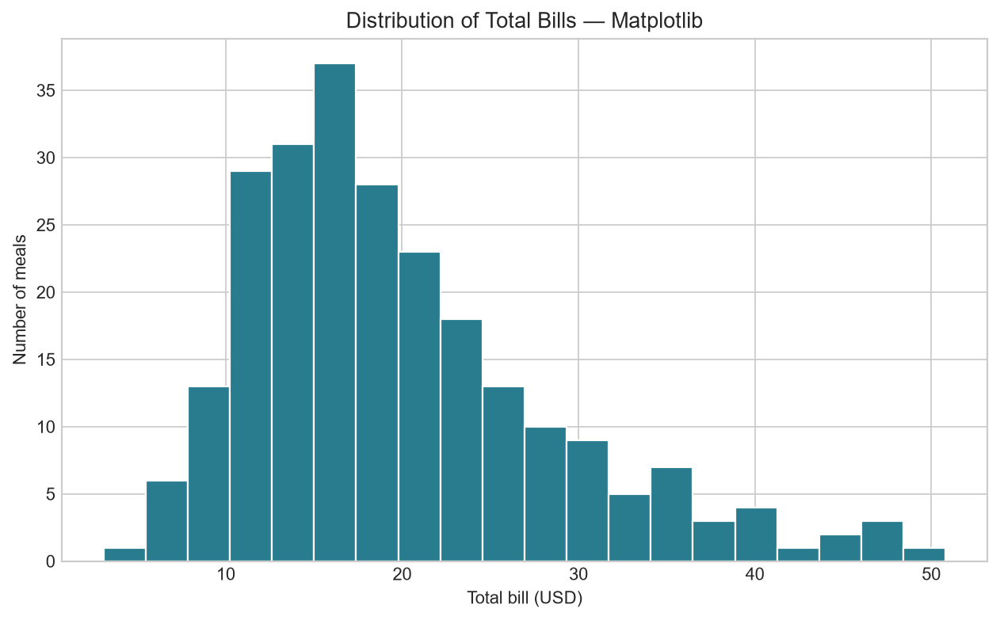

# Data Visualization Basics: Matplotlib and Seaborn

Practice creating the same five chart types with Matplotlib and Seaborn using Seaborn's built-in Tips dataset.

**Roadmap project:** https://roadmap.sh/projects/data-visualization-tutorial

## Charts

The project creates both Matplotlib and Seaborn versions of:

- Histogram of total bills
- Bar chart of average tips by day
- Box plot of total bills by day
- Scatter plot of tips versus total bills, grouped by smoker status
- Heatmap of numeric feature correlations

Example Matplotlib histogram:



Titles, axis labels, palettes, readable font sizing, and chart annotations are included. The runner saves all ten charts as PNG files in `outputs/`.

## Run locally

Python 3.10 or newer is recommended.

```bash
python -m venv .venv
```

Activate the virtual environment, then install the dependencies:

```bash
# Windows PowerShell
.venv\Scripts\Activate.ps1

# macOS / Linux
source .venv/bin/activate

python -m pip install -r requirements.txt
python visualize_tips.py
```

The dataset is loaded with `seaborn.load_dataset("tips")`, so the first run needs internet access. The charts are written into `outputs/`.

## Jupyter Notebook

Start Jupyter with:

```bash
jupyter notebook
```

Open `data_visualization_tutorial.ipynb` and run the cells from top to bottom. The notebook introduces each chart and compares the Matplotlib and Seaborn implementations.

## Project structure

```text
data-visualization-tutorial/
├── data_visualization_tutorial.ipynb
├── visualize_tips.py
├── requirements.txt
└── README.md
```
# data-visualization-tutorial
Matplotlib and Seaborn chart practice using the Tips dataset
